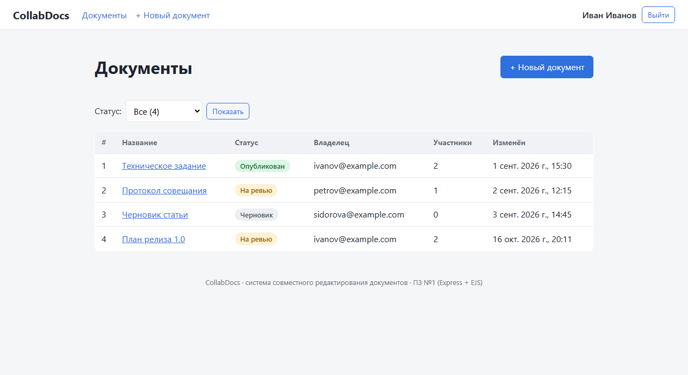
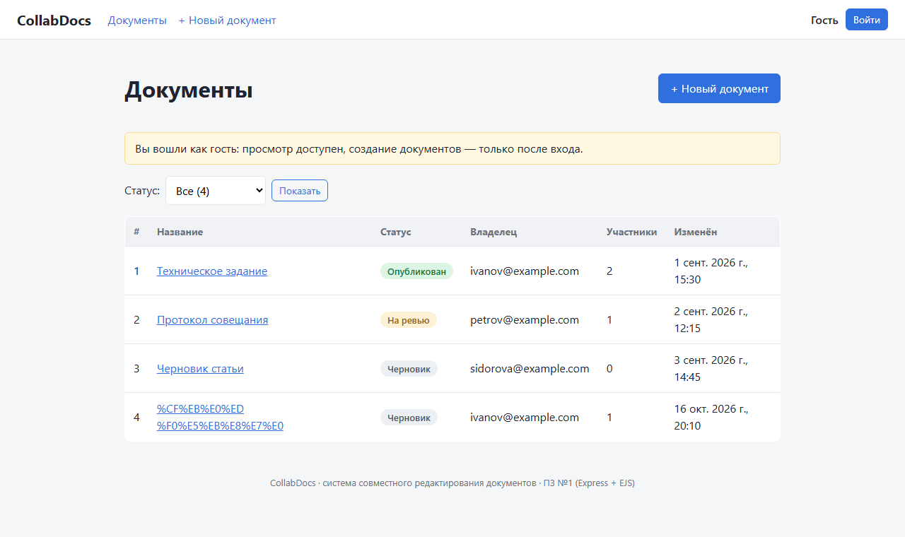
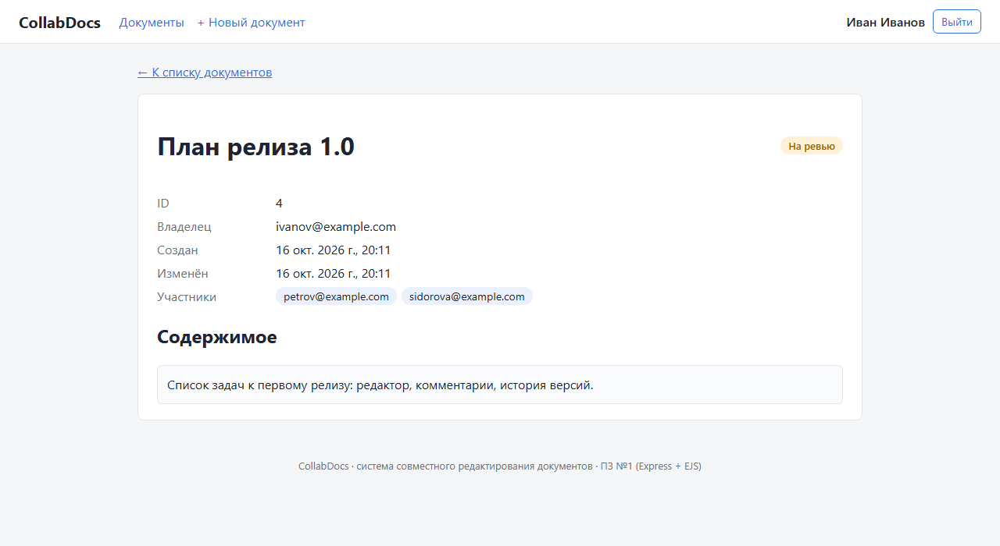
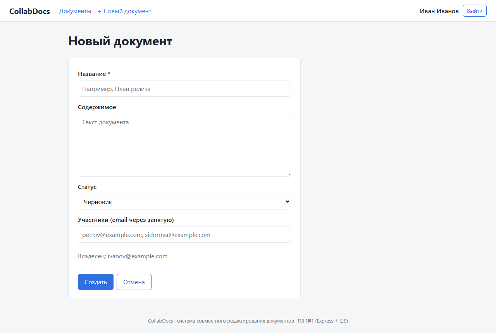
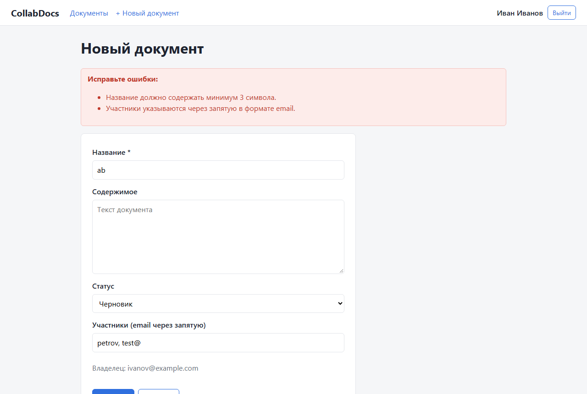
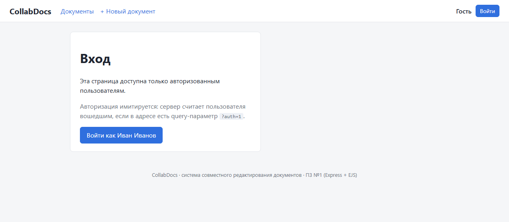
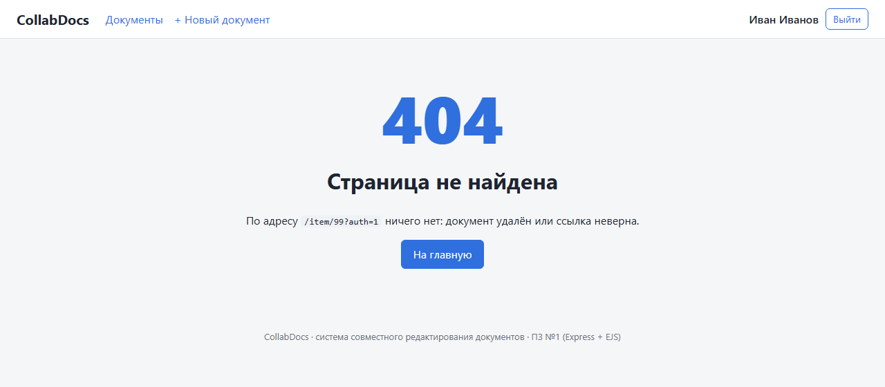
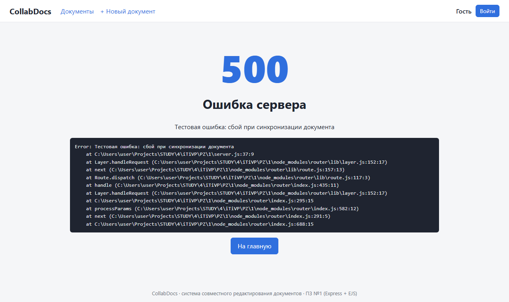

# Практическое занятие №1. Middleware и шаблонизаторы

**CollabDocs** — серверное веб-приложение на Express.js + EJS по теме курсового проекта «Система совместного редактирования документов». Продолжение лабораторных работ (REST API документов из ЛР №1–3, React-клиент из ЛР №4); здесь HTML-страницы генерируются на сервере шаблонизатором EJS. Данные хранятся в массиве в памяти, без базы данных.

Ветка для сдачи: `pz21`.

- Ответы на 30 контрольных вопросов: [docs/ANSWERS.md](docs/ANSWERS.md)
- Разъяснение по устройству проекта (что, где и зачем): [docs/EXPLANATION.md](docs/EXPLANATION.md)
- Скриншоты страниц: [docs/screenshots/](docs/screenshots/)

## Цель работы

Освоение концепции middleware в Express.js, разработка кастомных middleware для логирования, аутентификации, обработки ошибок. Изучение работы шаблонизатора EJS для генерации динамических HTML-страниц на сервере.

## Запуск

Требуется Node.js 18+.

```bash
npm install
npm start
```

Приложение: http://localhost:3000/

Режим разработки с автоперезапуском при изменении файлов: `npm run dev` (nodemon). Порт можно сменить переменной окружения `PORT`.

## Страницы и маршруты

| Метод | Маршрут | Доступ | Что делает | Шаблон |
| --- | --- | --- | --- | --- |
| GET | `/` | все | список документов, фильтр `?status=draft\|in_review\|published` | `index.ejs` |
| GET | `/item/:id` | все | детальная страница документа; нет документа → 404 | `item.ejs` |
| GET | `/add` | `?auth=1` | форма добавления документа | `add.ejs` |
| POST | `/add` | `?auth=1` | валидация, добавление в массив, редирект на `/` | `add.ejs` (при ошибках, код 400) |
| GET | `/login` | все | страница входа (имитация) | `login.ejs` |
| GET | `/error` | все | искусственная ошибка для демонстрации страницы 500 | `500.ejs` |
| * | любой другой | все | страница «не найдено» | `404.ejs` |

## Авторизация (имитация)

Пользователь считается вошедшим, если в адресе есть `?auth=1`:

- http://localhost:3000/?auth=1 — вход как «Иван Иванов» (`ivanov@example.com`);
- http://localhost:3000/ — гость (`req.user = { name: 'Гость' }`), может только смотреть;
- http://localhost:3000/add — гостя перенаправит на `/login`.

Все ссылки внутри приложения сохраняют `?auth=1`, поэтому после входа его не нужно дописывать вручную. Кнопка «Выйти» ведёт на адрес без параметра.

## Middleware

| Файл | Функция | Назначение |
| --- | --- | --- |
| [middleware/logger.js](middleware/logger.js) | `logger` | пишет в консоль время, метод, URL; после ответа — статус и длительность |
| [middleware/auth.js](middleware/auth.js) | `identifyUser` | по `?auth=1` выставляет `req.user` (пользователь или гость) и `res.locals` для шаблонов |
| [middleware/auth.js](middleware/auth.js) | `requireAuth` | на маршрутах `/add` перенаправляет гостя на `/login` |
| [middleware/errorHandlers.js](middleware/errorHandlers.js) | `notFound` | рендерит `404.ejs` |
| [middleware/errorHandlers.js](middleware/errorHandlers.js) | `serverError` | error-handling middleware (4 параметра): логирует ошибку, рендерит `500.ejs` |

Встроенные middleware Express: `express.static` (CSS из `public/`), `express.urlencoded` (данные форм в `req.body`).

Пример вывода логгера в консоли:

```
Сервер запущен: http://localhost:3000
[16.10.2026, 20:11:18] POST /add?auth=1
[16.10.2026, 20:11:18] POST /add?auth=1 -> 302 (26 мс)
[16.10.2026, 20:11:18] GET /?auth=1
[16.10.2026, 20:11:18] GET /?auth=1 -> 200 (10 мс)
```

## Структура проекта

```
├── server.js                      # точка входа: настройка EJS, порядок middleware, маршруты
├── data/documents.js              # массив документов в памяти + функции доступа
├── controllers/documentsController.js  # обработчики: list, show, addForm, create
├── routes/documents.js            # Router: /, /item/:id, /add
├── middleware/
│   ├── logger.js                  # логирование запросов
│   ├── auth.js                    # identifyUser, requireAuth
│   └── errorHandlers.js           # notFound (404), serverError (500)
├── views/
│   ├── partials/header.ejs        # общий каркас: <html>, <head>, шапка
│   ├── partials/footer.ejs        # закрывающая часть каркаса
│   ├── partials/status-badge.ejs  # переиспользуемый бейдж статуса
│   ├── index.ejs  item.ejs  add.ejs  login.ejs  404.ejs  500.ejs
├── public/css/style.css           # статические стили
└── docs/                          # ответы, разъяснение, скриншоты
```

## Скриншоты

| Главная (авторизован) | Главная (гость) |
| --- | --- |
|  |  |

| Детальная страница | Форма добавления |
| --- | --- |
|  |  |

| Ошибки валидации формы | Вход (редирект гостя) |
| --- | --- |
|  |  |

| 404 | 500 |
| --- | --- |
|  |  |
